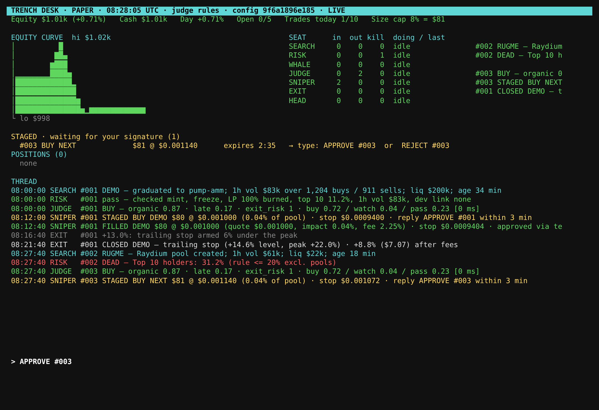

# Trench Desk

A Solana memecoin desk with seven seats and hard handoffs. The seats find, check, confirm and judge. **You sign.** Nothing is bought until you type `APPROVE #047`, and the desk never holds a private key.

```text
SEARCH  -> leads, each with an on-chain reason             (Scout)
RISK    -> contract and rug check. one hard fail = dead      (Filter)
WHALE   -> smart money confirm
JUDGE   -> four closed questions, the gate: buy/watch/pass   (Analyst, score 0-1)
SNIPER  -> stages the order, waits for APPROVE #id           (Executor)
EXIT    -> TP 2x, stop -50%, 60 min + 9 shadow plans          (Risk)
HEAD    -> runs the thread, dossiers, reports, calibration   (Logger)
```

JUDGE never sees a token RISK killed, and SNIPER never sees a token JUDGE didn't pass. Each seat reads only its own inbox. SNIPER also re-reads the lead from the store and refuses anything without a stored RISK `pass` and JUDGE `buy`, so a bug upstream can't leak a dead token into an order.

Python 3.9+ standard library only. It reuses the HTTP clients and contract parsing from [`../memecoin-scanner`](../memecoin-scanner). The optional `claude` judge backend needs `pip install anthropic`.

## Run

```bash
cd memecoin-desk
python3 desk.py run                    # live terminal, paper money ($1,000 by default)
```

```bash
python3 desk.py run --headless         # same desk, thread on stdout (tmux / VPS)
```

Sign from a second terminal, from the terminal's own command line, or from Telegram:

```bash
python3 desk.py approve 47
```

Other commands: `reject 47`, `fill 47 0.000123` (correct the entry after a manual fill), `pause`, `resume`, `status`, `thread -n 80`, `report`, `calibrate`, `lead 47` (full dossier, answers and gate for one lead), `strategy` (the shadow book). In the terminal, type `APPROVE #047`, `REJECT #047`, `PAUSE`, `RESUME`, `REPORT` or `QUIT`.

Phone (optional): create a bot with @BotFather, then:

```bash
TELEGRAM_BOT_TOKEN=123:abc TELEGRAM_CHAT_ID=your_id python3 desk.py run
```

Staged orders, fills, closes and the 21:00 report go to your phone, and replying `APPROVE #047` signs. Commands from any other chat are ignored and logged.

Smart money: put wallets you trust in `data/whales.txt` (`address,label`; see `examples/whales.txt`). Known ruggers go in `data/rug_wallets.txt`. Tests: `python3 -m unittest test_desk -v`.

## Trench: the trading screen

One screen with everything live: a radar of every new coin and every channel call, a live chart, safety checks, top holders, the trade tape, an order ticket, positions and a journal.

```bash
cd memecoin-desk
python3 trench_app.py            # then open http://127.0.0.1:8790
```

```bash
python3 trench_app.py --host 0.0.0.0 --port 8790    # on a server, to open it from your phone
```

| Part | What you get |
|---|---|
| Radar | Every pump.fun launch and graduation (PumpPortal), DexScreener profiles and boosts, GeckoTerminal new and trending pools, and Telegram calls. Tabs: Setups · Calls · All · New. Paste any mint into the search box |
| Tags | `setup` = under 48 h old, 20–60% below its 24 h high, 2x+ above its 24 h low, $50k+ 1 h volume, safety pass. `call` = posted by a channel. `top` = within 7% of the high after +50% in 6 h. `dead` = failed a safety check |
| Coin | Live candles (1m / 5m / 15m / 1h) with the 24 h high and your entry, stop and target, plus price, mcap, liquidity, volume, buys/sells, age, distance from the 24 h high and low, safety checks, top 10 holders, last 40 trades, and the call text if a channel posted it |
| Ticket | Four exit plans (Call 2x / −50% / 24 h, Fresh 2x / −50% / 60 m, Momentum −6% / trail after +12%, Runner half at 2x + trail). Size is set so a full stop-out costs 1% of the account. **Buy · Paper** fills at the live price plus impact and fees; **Open in Jupiter** is the real trade, signed in your own wallet |
| Positions | Live P&L, stop / entry / target rail, time left, Sell 50% / Sell all. The exit plan runs on the server every 4 s |
| Journal | Every closed trade with its reason |

Channels are listed in `config.json` → `app.channels` (public channel usernames, read from `t.me/s/<name>`). Limits from `config.json` apply: no averaging down, 5 open, a cooldown after a loss, and the daily stop.

## The cockpit

The [Trench Cockpit](https://claude.ai/code/artifact/07137e3d-8557-44fc-aa7e-ddddbba4ccb5) is a page in Claude with everything in one place:
- **Now:** the market pulse, today's read, the strategy head-to-head, trending pools
- **Desk:** equity, staged orders, positions, kills, the thread
- **How coins move:** the lifecycle study and the entry × exit backtest
- **Calls check:** a channel's calls checked on-chain
- **Playbook:** the rules, with the evidence behind each
- **Ask Claude:** a chat that answers from the same numbers

The numbers sit in the page's database. Ask Claude in Claude Code to refresh them; it runs:

```bash
python3 -I cockpit.py --pulse 10
```

That listens to the market for 10 minutes, rebuilds the snapshot from `data/` (desk database, channel check, research), and Claude writes it to the page. To check a channel, upload its Telegram export and run:

```bash
python3 -I channel.py <export.json>
```

The tools behind it:

| Tool | What it does |
|---|---|
| `pulse.py` | Market pulse: launches and graduations an hour (PumpPortal), SOL, trending, boosts |
| `lifecycle.py` | How young coins move: peaks, time to peak, shakeouts, the fall after the peak, volume timing |
| `channel.py` | A Telegram call channel checked on-chain from a follower's entry |
| `cockpit.py` | Builds the page snapshot; `cockpit_page.html` is the page |

[BEST_PRACTICE.md](BEST_PRACTICE.md) is the full playbook.

## The terminal



The screenshot is an offline replay of the signing path, with fake quotes: BUY → STAGED → `APPROVE` → FILLED → trailing stop armed at +13% → closed at +8.8% after fees.

## What each seat does

**SEARCH (Scout).** Three real-time feeds over a standard-library websocket client:
- PumpPortal: every pump.fun and LaunchLab launch and graduation, plus the trades of your tracked wallets.
- Solana `logsSubscribe` on the Raydium CPMM and AMM v4 programs: every new pool.
- A GeckoTerminal/DexScreener poll as backup.

New tokens wait in a nursery. Each minute SEARCH re-reads them 30 at a time and promotes one to a lead once its 1-hour volume reaches $50k and its liquidity $10k. Each lead carries its on-chain reason, for example "graduated to pump-amm; 1h vol $83k over 1,204 buys / 911 sells on pumpswap; liq $41k; age 34 min".

**RISK (Filter).** One hard fail = dead. **A check that can't be run is a fail.**

| Check | Rule |
|---|---|
| Mint authority | revoked |
| Freeze authority | revoked |
| LP burned / locked | ≥ 95% (a pump.fun bonding curve counts: nobody can withdraw it) |
| Top 10 holders | ≤ 20%, excluding pools and lockers |
| 1-hour volume | ≥ $50k on the token's own pools, and the busiest pool must actually report it |
| Dev wallet | not in the rug registry, and its first funder not either |
| RugCheck | no danger flags, not flagged rugged |
| Token-2022 | no PermanentDelegate, TransferHook, TransferFee, NonTransferable, Pausable or frozen-by-default |

The rug registry fills itself. HEAD re-prices every lead 24 h later and records the creator and the creator's funder of any token that fell 90% or more or was delisted. The free APIs here don't list a dev's past tokens, so the registry starts empty and gets stronger every day the desk runs. Seed it with `data/rug_wallets.txt`.

**WHALE.** It reports which tracked wallets bought the token (from the PumpPortal trade stream) or hold it (from the top-holder list), and when. It confirms or stays quiet. It never kills or sizes, unless you set `whale.require_confirm`.

**HEAD → dossier.** HEAD builds one dossier per lead, with facts only:
- age, market cap, liquidity
- holders now vs 1 h ago, and price over the same hour
- buys vs sells in the last two 5-minute windows
- top 10 and dev share
- what RISK checked, and what WHALE saw
- your order size as a share of the pool

**A missing field is written `"missing"`, never guessed.** Holder history comes from the desk's own snapshots, so a lead the desk first saw 10 minutes ago honestly has no "1 h ago". Social mentions are always `"missing"`: no free source exists.

**JUDGE (Analyst).** It asks the same four questions every time, with the wording fixed in `judge.py`:
- **organic:** yes / no
- **late:** yes / no
- **exit_risk:** 1–5
- **action:** buy / watch / pass

Code applies the gate in `config.json`. Buy only if all of these hold:
- action = buy with p ≥ 0.70
- organic = yes with p ≥ 0.65
- late = no
- exit_risk ≤ 3
- analyst score (= p(buy)) ≥ 0.60

A lead the desk has only just seen has no holder history yet. The rules judge answers that with "watch", not "pass": not yet, not no. A watch is asked once more after 30 minutes, starting again from RISK so every fact is fresh. A second watch is a pass. No answer is a pass. Every verdict is logged with every probability and the answer that killed it.

**SNIPER (Executor).**
- **Size:** by risk. Each trade is sized so a full stop-out (stop + fees) costs 1% of the account: with a −50% stop, that's about $18 on $1,000. It's never more than 8% of equity, 2% of pool liquidity, or the cash you have. Confidence never changes size: a 0.92 buy gets the same size as a 0.71 buy.
- **Approval window:** an order waits 3 minutes for `APPROVE #id`. The approval is refused if price ran more than 5% above the staged quote, because that would be chasing.

**EXIT (Risk).**
- **Live plan:** strategy A: sell 100% at 2x, stop −50%, out after 60 minutes (`exit.plan`). It matches JUDGE's pullback entry and is the only pairing backed by the 148-call data; see [AUDIT.md](AUDIT.md). The trader's −6% / +12% exit runs as a shadow plan (strategy B, paired with entries near the high).
- **Other exits:** if the pool loses half its liquidity, EXIT sells at once. Stops fill at the price actually seen, never at the stop level.
- **Shadow plans:** every trade, and every lead RISK passes (the shadow book), also runs all 9 exit plans in `exit.shadow_plans` with no money. `desk.py strategy` shows which plan, verdict and entry position actually made money.
- **One engine:** live exits, shadow plans and `backtest.py` all use `exits.py`, so what was tested is exactly what runs.

**Limits, enforced in code:**
- **No averaging down:** never a second order on a token you hold.
- **No revenge trades:** after a losing close, no new order for 30 minutes. Never re-enter a token that stopped you out in the last 24 h.
- **Losing streak:** 3 losses in a row pause the desk until 00:00 UTC.
- **Daily stop:** −5% of the day's opening equity.
- **Caps:** at most 5 positions open and 10 trades a day.

**HEAD (Logger).** Every lead, kill, verdict, order, fill and close goes to the thread with its reason (`data/desk.db`, `desk.py thread`).
- **Evening report:** at 21:00 in `head.report_tz` (UTC by default; set yours), written to `data/reports/` and sent to Telegram.
- **Sunday calibration:** every Sunday the report adds the calibration table. Buy answers are grouped by p(buy) (0.70–0.79, 0.80–0.89, 0.90+), with trades and green closes for each group, plus how many passes were up 24 h later. If 0.90+ doesn't win more often than 0.70–0.79, it says so plainly.

## The judge: why not Jev, and what replaces it

The trader's design calls TypeSafe's Jev model. This desk doesn't use the Jev API. It keeps the TypeSafe pattern instead: **the model answers judgments, code decides.** Questions are fixed, typed and closed. Probabilities feed a written gate. "No answer" is a pass. Confidence never sizes. The TypeSafe skill is installed in Claude Code for working on this project. The `judge.backend` setting picks who answers:

- `rules` (default). Deterministic and offline, answering in under 1 ms. Each answer comes from stated checks on the dossier:
  - holders up faster than price
  - buys above sells in both 5-minute windows
  - tiny average trades (bot churn)
  - linked wallets or a bundle signature
  - distance from the 60-minute high
  - hourly and 6-hour gains
  - order share of the pool

  The reasons are logged (`desk.py lead 47` → `verdict.answers.why`). These probabilities are **not calibrated** until the Sunday table says they are.
- `claude`. The same four questions are sent to the Claude API with a JSON schema. This uses `claude-opus-5-5` at low effort, which is slower than a second. Change `judge.claude_model` if you want a faster model. It needs `pip install anthropic` and `ANTHROPIC_API_KEY`. A refusal, timeout or error is "no answer", which is a pass.

## Read this before trusting it with money

[AUDIT.md](AUDIT.md) has the full audit and today's backtest (97 young pools). In short:
- **No proven edge yet.** With only the volume filter as the entry, every exit plan loses once outliers are capped. The entry decides the money.
- **The trader's −6% / +12% exit is a momentum exit.** Paired with buying young coins near their 60-minute high, it made +6.4% a trade. Paired with the pullback entry that JUDGE prefers, it lost −3.5% a trade, with the whole range below zero.
- **The two datasets disagree on the entry.** The 148 calls favour the pullback; today's sample favours the high, but that sample leans toward coins that ended up big. The shadow book settles it on the desk's own leads: `desk.py strategy` shows A (pullback + 2x / −50%) against B (near the high + trailing exit).
- **Live paper plan:** A, sized so a stop-out costs 1% of the account.

Run it in paper mode for 2–4 weeks. Switch the live strategy only when the head-to-head shows one side with 100+ shadow trades and a positive capped average and median in both halves of the period. If B wins, also change JUDGE's `late` gate, since it vetoes buys near the high. Then set `"mode": "manual"`: APPROVE prints the Jupiter link and the amount, you sign in your own wallet, and `FILL #id <price>` records your real entry. This is not financial advice.

## Files

| File | What |
|---|---|
| `config.json` | every threshold. The desk reads it and never writes it; the thread logs its hash at each start |
| `desk.py` | entry point, wiring, commands |
| `search.py` · `risk.py` · `seats.py` · `judge.py` · `sniper.py` · `report.py` | the seats |
| `exits.py` | the one exit engine (live, shadow plans, backtest) |
| `backtest.py` | entry rules × exit plans on recent young pools (`fetch`, then `run`) |
| `AUDIT.md` | the strategy audit and its evidence |
| `tui.py` | the live terminal |
| `wsclient.py` | standard-library websocket client (proxy-aware) |
| `store.py` | SQLite: leads, thread, orders, positions, equity, snapshots, rug registry, whale trades |
| `telegram.py` | optional phone push and APPROVE from the phone |
